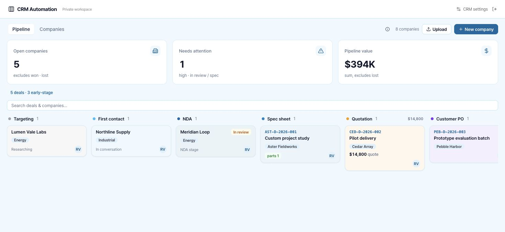
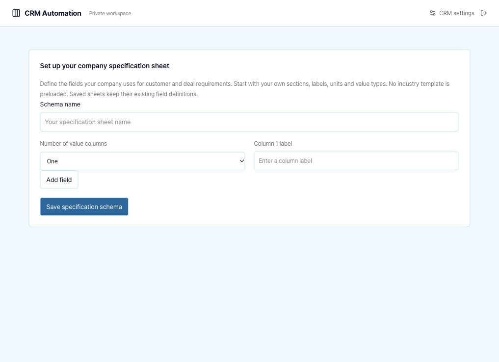
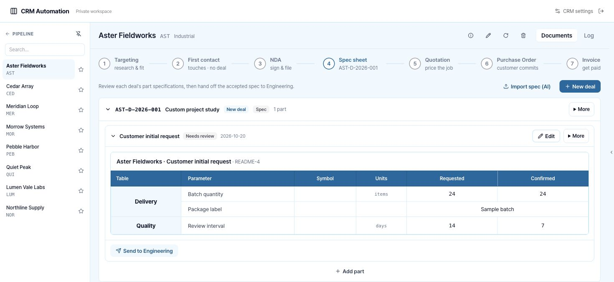

# CRM Automation

English · [한국어](README.ko.md)

CRM Automation is a private CRM for managing companies, contacts, deals, engineering requirements, quotations and customer follow-ups.

[Before you start](#before-you-start) · [Quick start](#quick-start) · [Workflows](#workflows) · [Architecture](#architecture) · [Verification](#verification) · [Current limitations](#current-limitations)



*README screenshot examples use fictional companies, contacts and deals saved through the actual local API. They are never seeded into hosted workspaces.*

## Before you start

The database starts empty. On first sign-in, configure your company specification schema before opening the CRM. Supply your own organisation, assignment directory and customer records. No company accounts, credentials, contacts or production records are bundled. The optional screenshot fixture helper is local-only.

| Requirement | Required for | Setup |
| --- | --- | --- |
| Node.js 22.13 or newer and npm | Local development/build | Install Node, then `npm ci` |
| Cloudflare D1 binding `DB` | Every saved record and CRM settings | Migrations in `drizzle/`; binding is declared in `.openai/hosting.json` |
| Production authentication | Private hosted workspace | Existing Sites identity, or your own Cloudflare Access application via the [self-hosting guide](docs/SELF-HOSTING.md). Local development needs neither account |
| R2 binding `BUCKET` | Uploaded documents, build files, inspection photos, customer attachments and executed NDAs | Declared in `.openai/hosting.json`; local storage is emulated by Wrangler |
| `OPENAI_API_KEY`, `OPENAI_MODEL` | AI intake, document/spec/PO extraction, draft adjustment, email briefing/routing and NDA field drafts | Optional server-only secrets; both values are required |
| `GMAIL_ACCESS_TOKEN`, `GMAIL_SENDER_EMAIL` | Explicit email delivery, NDA requests and customer requirement requests | Optional user-owned Google account with `gmail.send`; token expiry requires replacement |
| `PUBLIC_APP_URL` | NDA/customer requirement links | Optional HTTPS origin of this workspace, supplied on the server |
| Organisation legal name/address, entity description, your own NDA agreement terms, authorised signer | Print identity and signature workflows | Enter your own values in **CRM settings** |

**The hosted release is owner-private. External customers cannot use its links until the owner deliberately changes the hosting audience. Signing and customer requirement endpoints can be tested locally; this repository does not change the private audience.**

Core company/contact/deal, manual requirement/spec, company document/execution, activity/comment/reaction, change-request and follow-up workflows do not require OpenAI or Gmail. Missing external credentials produce a setup error; they never produce a fake extraction or a successful email status.

### Configure your specification schema

First-run setup asks for the specification format your company actually uses. Enter a schema name, name one or two value columns, add your sections and fields, and choose text or number for each field. Save to continue. You can update this format later in **CRM settings → Company specification schema**. Configuration is stored in your owner-scoped D1 records, not in browser storage. New customer and deal sheets use the saved format; existing versions and customer requests keep their original field snapshots. User-entered labels and values remain in their original language.





### Prepare your own data

| Entry point | Data you provide | Format / required fields |
| --- | --- | --- |
| Company form | Real customer organisation | Name; reference is generated; sector/stage/priority use the original CRM enums; optional contact, address and value |
| Contact form | Customer contact | Name and customer link; a valid email is required for customer request delivery |
| Deal workspace | Customer opportunity | Title and company or in-house context; generated deal number; owner selected from your directory |
| Specification setup | Your company requirement format | Schema name; 1–2 custom value columns; 1–80 fields with section, unique label, optional unit/symbol, text or number type, and single/separate column values. No preloaded industry fields |
| Requirement editor | Customer/deal requirements | Uses your saved schema; each version retains its field definitions and column labels |
| Customer requirement workbook | Actual customer response | Download the workbook from that private request. Keep `Spec Sheet`, customer identity, column headings `Section`, `Field`, `Symbol`, `Unit`, your configured value columns, and field rows. Enter values; formulas are rejected. Limit: 2 MB |
| Spec extraction | Actual customer spec document | XLSX converted to text by the retained SheetJS parser, or PDF/image; AI credentials required for extraction |
| Document intake | Actual quotation/PO/invoice | PDF or image; AI credentials required; extracted fields remain reviewable drafts |
| Attachments | Actual owned files | Build/document files up to 50 MB; customer requirement attachments up to 2 MB with type/extension checks |

This service does not offer a generic CSV customer import, automatic mailbox collection, bank connector or cross-service finance API. An invoice handoff creates an owned finance-handoff record in this workspace; it does not claim delivery to a separate finance service.

## Quick start

```sh
git clone https://github.com/dpwld/crm-automation.git
cd crm-automation
npm ci
npm run setup
npm run dev -- --port 4323
```

Local setup needs no ChatGPT account or paid API keys. The repository is currently private, so cloning requires access. `npm run setup` builds the service and applies committed local migrations without seeding data. See [Installation](docs/INSTALLATION.md), [Self-hosting in your own Cloudflare account](docs/SELF-HOSTING.md), and [Contributing](CONTRIBUTING.md).


The checked-in migrations can be applied directly; `db:generate` is needed after changing `db/schema.ts`. The local development server uses the starter’s loopback-only sign-in and Miniflare D1/R2 persistence under `.wrangler/state`. `npm start` runs the built Worker for gateway/integration verification. The Sites deployment pipeline provisions the declared bindings and applies migrations.

Optional integrations use server environment variables. For native development, copy `.env.example` to `.env.local`, fill your own values and restart `npm run dev`. For the built Wrangler Worker, copy the template to ignored `.dev.vars` and restart `npm start`. Hosted credentials belong in the private deployment’s server secret configuration. Never prefix credentials with `NEXT_PUBLIC_` or commit `.dev.vars`/`.env` files.

The existing hosted instance uses Sites sign-in; independent deployments use the documented Cloudflare Access mode. `npm run dev` enables the starter’s loopback-only sign-in screen; its middleware strips incoming identity headers and supplies a local session only after sign-in. For isolated built-Worker API verification, the test harness sends disposable identity headers to the loopback Worker. Do not expose the standalone development Worker publicly.

## Workflows

The interface ports the original CRM components and their domain functions. Its company and deal tabs retain the original structure. The header opens a compact CRM settings dialog; this repository does not include adjacent platform workspaces.

- Start with the company board or table, search/filter, favorite a customer and open its contact/detail rail.
- Record targeting research, first contact, sales activity, next action and follow-up. Keep company and deal timelines, comments, mentions and reactions together.
- Create independent deals and move through first contact, NDA, specification, quotation, customer PO, invoice and completion; execution states retain manufacturing/testing/shipping/aftercare semantics.
- Edit requirement tables, version part specifications, mark a final version and hand it to engineering. Track company build checklists, parts, procurement status, arrivals, inspection and experiments. Separate procurement/part-tracker services are not connected; their outbound actions are visibly disabled.
- Draft quotations, purchase orders and invoices; manage catalog items, line items, currency, discounts, tax and linked revisions. Number documents by counterparty/year using durable counters. Print/PDF uses your saved organisation details and terms.
- Send a private customer requirement request after configuring email and the service origin. Customers can save/submit structured values and attachments. Review compares the current part and applies an incoming submission to a new draft version.
- Save your own NDA agreement terms in CRM settings, then send for signature and preserve its document snapshot/hash, receive drawn/typed customer signature and consent, then countersign explicitly. The executed PDF and signature certificate are stored in R2; email delivery failures remain visible.
- Use real AI adapters for intake, extraction, comparison, drafts and email routing after setup. AI results remain drafts for human review.

[Feature parity inventory](docs/FEATURE-PARITY.md) maps the source surfaces to implementation. [Implementation report](docs/IMPLEMENTATION-REPORT.md) lists verification and remaining dependencies.

### Optional fictional README preview

After starting `npm run dev -- --port 4323 --host 127.0.0.1`, run:

```sh
npm run readme:seed
# Capture the actual local CRM, then remove only these examples:
npm run readme:cleanup
```

The helper accepts only HTTP loopback port 4323, confirms the native local sign-in and inserts exact `readme-crm--` IDs. It refuses an existing fixture namespace and never upserts records. Cleanup refuses non-fixture records linked to the examples. It does not run at startup, migration or deployment and never calls email/AI providers. Keep screenshot examples separate from your real customer data.

## Architecture

React/Vinext runs on Cloudflare Workers. D1 stores validated original-domain JSON records behind structural owner/entity/id keys, plus separate atomic numbering counters, private-link hashes, action guards, file metadata and integration-run logs. All browser mutations use authenticated server endpoints with table/action/field allowlists and owner checks. R2 objects are private and streamed only after ownership or a valid private-link check.

The original Supabase data-function contracts remain in `lib/data`; their client now transports queries to owned D1 endpoints. No Supabase account or company backend is required. Business records are not stored in browser localStorage; panel sizes/pins/sort preferences may be stored locally.

SheetJS 0.20.2 is retained from the original vetted vendor archive. Its package license and bundled third-party license notices remain with the dependency. Pretendard's font license is in `public/fonts/OFL.txt`. This repository is private and has no blanket open-source license pending ownership review.

## Verification

```sh
npm test
npm run typecheck
npm run build
```

With an isolated built Worker running at loopback `CRM_TEST_URL` (default `http://127.0.0.1:4313`), `npm run test:server` runs HTTP assertions against actual D1/R2. Use an isolated persistence directory, as this suite writes disposable test-owner fixtures. Domain/server verification commands and observed results are recorded in [IMPLEMENTATION-REPORT.md](docs/IMPLEMENTATION-REPORT.md). External sends and paid AI calls are excluded from automated verification.

## Current limitations

- Google OAuth authorisation/refresh and scheduled mailbox collection are not implemented. Configure an owned `gmail.send` access token manually; expiry fails visibly. AI email briefs use saved email text and identify themselves as partial; mailbox attachment retrieval is not implemented.
- Hosting stays owner-private. Customer signing/requirement links need an intentional audience decision before external distribution.
- Separate Engineering, Procurement, Approvals, DocsHub, Studio and global NDA applications are outside this CRM repository. The company NDA flow and its recipient signature page remain because the original CRM directly requires them.
- The finance handoff stores the original invoice payload locally; authenticated delivery to a separate finance service requires a configured cross-service contract.
- The assignment directory supports ownership/mentions inside one account's data. Shared multi-user tenancy and live presence are not implemented.
- Agreement PDF uses the original English/Latin character limitation. The server validates supported legal identities rather than silently corrupting the document.
- No recurring/background job is silently activated. Integration attempts are persisted; automatic schedulers need explicit configuration.
